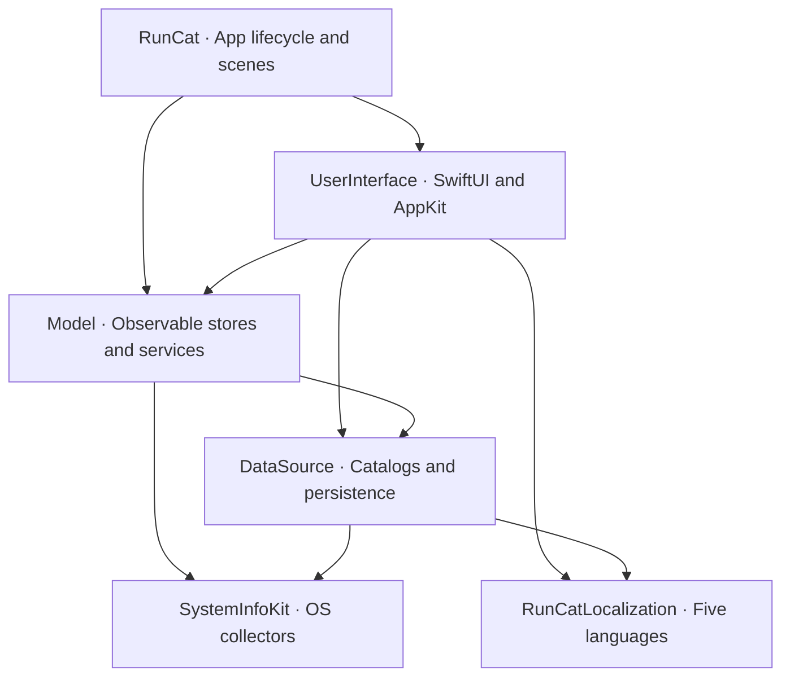

# RunCat Classic

[](https://github.com/HAOGRE/RunCatClassic/releases/tag/v1.0.0)


**让经典跑猫继续跑在新 macOS 上。Reviving the classic RunCat experience on modern macOS.**

[下载 / Download](#download) · [中文](#中文) · [English](#english) · [Gallery](#gallery) · [自制跑者 / Self-Made](#self-made-runners) · [FAQ](#faq) · [构建 / Build](#build-test--install) · [致谢 / References](#references)

<a id="download"></a>
## Download / 下载安装

**[Download RunCat.dmg (v1.0.0)](https://github.com/HAOGRE/RunCatClassic/releases/latest/download/RunCat.dmg)**

打开 DMG，将 `RunCat.app` 拖入 `Applications`，再从「应用程序」启动。v1.0.0 的 DMG 为 Apple Silicon（arm64）构建；系统最低要求 macOS 14，已在 macOS 27.2 验证。Intel 用户可从源码构建，尚未实机验证。

Open the DMG, drag `RunCat.app` into `Applications`, then launch it from Applications. The v1.0.0 DMG is built for Apple Silicon (arm64), targets macOS 14+, and was verified on macOS 27.2. Intel users can build from source; Intel hardware has not been verified.

发行包使用 ad-hoc 签名，未经过 Apple 公证。如果首次打开被 Gatekeeper 阻止，请在确认下载来自本仓库后运行：

The release is ad-hoc signed and is not Apple notarized. If Gatekeeper blocks the first launch, run this after confirming you downloaded it from this repository:

```sh
xattr -dr com.apple.quarantine /Applications/RunCat.app
open /Applications/RunCat.app
```

## 中文

RunCat Classic 是 [HAOGRE](https://github.com/HAOGRE) 维护的社区复活工程，**项目版本为 1.0.0，经典体验基于 RunCat 12.2.1**。依据经典版资源、Swift 类型元数据、原始本地化表与资源清单重建菜单和交互，保留原作者 Takuto Nakamura（Kyome）的署名。本工程为独立社区项目；官方现代开源版本请见 [RunCatNeo](https://github.com/runcat-dev/RunCatNeo)。

- **完整经典内容**：78 个内置跑者（含 7 个彩色角色）、经典 Dashboard、随机选择、强调色与独立系统信息栏。
- **自制跑者**：独立编辑窗口，最多 50 帧 PNG，支持模板或原色、拖放重排和动画预览。
- **系统指标**：CPU、内存、存储、电池和网络；兼容 macOS 27 的嵌套 `BatteryData` / `AppleSmartBatteryPack` 数据结构，保留传统 Apple Silicon / Intel 采集路径。
- **经典浏览方式**：59 项商品与原始 APNG 预览；社区模式免费解锁目录，保留选用与恢复入口，不执行真实付费交易。
- **五种语言**：English、简体中文、日本語、한국어、Français。

结构、布局常量、资源与主要交互以经典版为依据；系统原生控件外观会随 macOS 变化，尚未完成跨系统逐像素验收。

## English

RunCat Classic is a community revival maintained by [HAOGRE](https://github.com/HAOGRE). **This project's version is 1.0.0; its classic experience is based on RunCat 12.2.1.** It reconstructs the classic menus and interactions from original resources, Swift metadata, localization tables and a resource manifest, retaining attribution to Takuto Nakamura (Kyome). For the official modern open-source RunCat for macOS, see [RunCatNeo](https://github.com/runcat-dev/RunCatNeo).

- **Classic catalog:** 78 built-in runners, including 7 color runners, the classic dashboard, random selection, accent tint and a separate system information bar.
- **Custom runners:** a separate editor for up to 50 PNG frames, template/original color, drag-to-reorder and animation preview.
- **System metrics:** CPU, memory, storage, battery and network, including the nested macOS 27 battery schema and traditional Apple Silicon / Intel collector paths.
- **Product browser:** 59 classic products with original APNG previews; community mode unlocks selection and retains restoration UI without real purchases.
- **Five languages:** English, Simplified Chinese, Japanese, Korean and French.

The restoration follows classic structure, layout constants, assets and interaction semantics. Native controls vary by OS; cross-version pixel-for-pixel equivalence has not been established.

## Classic vs RunCatNeo / 经典版与 Neo 对比

Neo 列依据固定源码快照 [`592cd606`](https://github.com/runcat-dev/RunCatNeo/tree/592cd606e735ce20da98d9ae62ecf1a2608635d7)，不代表后续版本。Classic 列描述本工程。

The Neo column refers to that pinned source snapshot; later versions may differ. Classic describes this project.

| 特性 / Feature | RunCat Classic v1.0.0 | RunCatNeo · Pinned snapshot |
|---|---|---|
| 系统要求 / Deployment | macOS 14+；验证 / verified on 27.2 | macOS 26+ target |
| 内置跑者 / Built-in runners | 78，含 7 个原色 / including 7 color runners | 8，均模板 / all template |
| 默认猫 / Default cat | 5 帧 / frames，28×18 pt | 相同可见像素 / same visible pixels |
| 动画 / Animation | 离散 Core Animation；变速保相位 / discrete, phase-preserving | 相同基础数学 / same core mathematics |
| 导航 / Navigation | 经典 Dashboard、两 Tab 设置 / classic dashboard, two settings tabs | 现代菜单和设置 / modern menus and settings |
| 商品浏览 / Product browser | 59 项，社区免费选用 / free community selection | 无经典商店 / no classic store |
| 自制跑者 / Custom runners | 独立窗口，最多 50 帧 / separate window, up to 50 frames | 设置内编辑，最多 30 帧 / settings editor, up to 30 frames |
| 颜色 / Color | 模板、原色、强调色 / template, original, accent | 内置模板、自制可原色 / built-in templates, custom original color |
| 随机与停止 / Random & stop | 经典范围与确认流程 / classic scope and confirmation | 流程不同 / different workflow |
| 系统信息栏 / Metrics bar | 经典百分比、条形、饼图等 / classic indicator modes | 现代 MetricsBar / redesigned metrics bar |
| JSON 自定义指标 / Custom metrics | 未实现 / not implemented | 文件监听 / file watching |

<a id="gallery"></a>
## Gallery / 界面预览

原生 SwiftUI / AppKit 浅色模式截图；桌面 Mac 示例不显示电池详情，展示 IP 已替换为文档地址 `192.0.2.1`。

Native SwiftUI / AppKit screenshots in light appearance. The desktop example omits battery details; the displayed IP is masked with `192.0.2.1`.

| Dashboard / 主面板 | Runners / 跑者 |
|---|---|
|  |  |
| General / 通用设置 | System Info / 系统信息设置 |
|  |  |
| System Info Bar / 信息栏 | Self-Made / 自制跑者 |
|  |  |


<a id="self-made-runners"></a>
## Self-Made Runners / 自制跑者注册指南

1. 点击菜单栏跑猫，进入 **Runners / 跑者 → Self-Made / 自制**，打开独立的自制跑者窗口。
2. 输入不重复的名称。点击帧列表下方 **+ / Add PNG**，或拖入 PNG 文件，添加 **1–50 帧**。每帧高度须为 **36 px**，宽度须为 **10–100 px**。
3. 勾选 **Use original color / 使用原色** 保留 PNG 颜色；关闭时以模板方式渲染，随菜单栏外观或强调色着色。
4. 拖动帧缩略图调整播放顺序，选中帧后可用 **−** 删除；使用预览速度滑块检查动画。
5. 点击 **Register / 注册**。跑者会保存到本机，并出现在 **Self-Made / 自制** 分类中；从该分类选择即可使用。

1. Click the menu bar runner and choose **Runners → Self-Made** to open the separate editor.
2. Enter a unique name. Click **+ / Add PNG** below the frame list, or drop PNG files into it. Add **1–50 frames**, each **36 px high** and **10–100 px wide**.
3. Enable **Use original color** to retain PNG colors. Disable it for template rendering that follows the menu bar appearance or accent tint.
4. Drag frame thumbnails to reorder playback; select a frame and use **−** to remove it. Check the animation with the preview speed slider.
5. Click **Register**. The runner is saved locally and appears in the **Self-Made** category, where you can select it for the menu bar.

<a id="faq"></a>
## FAQ / 常见问题

**这是官方 RunCat / RunCatNeo 吗？Is this the official RunCat / RunCatNeo?**

这是基于经典 12.2.1 体验的独立社区复活项目，使用自己的 v1.0.0 版本号。官方现代 macOS 开源项目为 [RunCatNeo](https://github.com/runcat-dev/RunCatNeo)，由 Takuto Nakamura / runcat-dev 开发。

This is an independent community revival of the classic 12.2.1 experience with its own v1.0.0 version. [RunCatNeo](https://github.com/runcat-dev/RunCatNeo) is the official modern open-source macOS project by Takuto Nakamura / runcat-dev.

**首次打开被阻止怎么办？What if the first launch is blocked?**

发行包未公证，请按[下载安装](#download)中的步骤，在确认来源后移除 quarantine 属性。

The release is not notarized. Follow the [download instructions](#download) to remove quarantine after checking the source.

**支持哪些 Mac？Which Macs are supported?**

部署目标 macOS 14+，已在 Apple Silicon、macOS 27.2 验证。v1.0.0 DMG 为 arm64；Intel 可从源码构建，跨系统、Intel 和多显示器硬件矩阵仍需更多验证。

The deployment target is macOS 14+, verified on Apple Silicon with macOS 27.2. The v1.0.0 DMG is arm64; Intel can be built from source. Wider OS, Intel and multiple-display coverage still needs testing.

**为什么跑者速度会变化？Why does the runner change speed?**

默认速度跟随 CPU 使用率，采用经典公式与离散 Core Animation 帧。设置可调整速度行为；反向速度与水平翻转是独立选项。

By default, playback follows CPU usage using the classic speed formula and discrete Core Animation frames. Settings control speed behavior; inverse speed and horizontal mirroring are separate options.

**为什么没有电池详情？Why are battery details missing?**

无电池的桌面 Mac 会隐藏电池详情。笔记本的采集路径兼容新旧 IORegistry 字段，但实际可用值取决于硬件与系统。

Desktop Macs without a battery hide battery detail rows. The collector supports old and new IORegistry layouts; available values depend on hardware and OS.

**商店是否收费？Does the store charge money?**

社区模式免费解锁内置目录和自制功能，保留经典浏览界面，不执行真实付费交易。

Community mode unlocks the catalog and custom-runner editor, preserving the classic browser without real purchases.

**如何报告问题或参与？How do I report issues or contribute?**

使用 **More → Report an Issue** 打开预填版本与系统信息的 [GitHub Issue](https://github.com/HAOGRE/RunCatClassic/issues/new)，提交前可编辑内容。**More → Contribute to RunCat** 打开本仓库；欢迎 Issue 与 Pull Request。

Use **More → Report an Issue** to open a [GitHub issue](https://github.com/HAOGRE/RunCatClassic/issues/new) with version and system details prefilled; review and edit them before submitting. **More → Contribute to RunCat** opens this repository. Issues and pull requests are welcome.

## Architecture / 架构



| 模块 / Module | 职责 / Responsibility |
|---|---|
| `RunCat` | 应用入口、Scene、图标和版本信息 / app shell, scenes, icon and bundle metadata |
| `UserInterface` | Dashboard、设置、商店、自制编辑器与状态栏图层 / classic views and status-bar rendering |
| `Model` | `@MainActor @Observable` Store、Action、监控与睡眠唤醒 / state, actions, services and sleep/wake |
| `DataSource` | 目录、依赖客户端、UserDefaults 与 Application Support / catalogs, dependency clients and persistence |
| `SystemInfoKit` | Mach、IOKit、SystemConfiguration 系统指标 / CPU, memory, storage, battery and network collectors |
| `RunCatLocalization` | 五语言 × 八业务表 / five languages across eight business tables |

活动模块位于 `LocalPackage/Sources/`，无远程 SwiftPM 依赖。`LocalPackage/Packages/SystemInfoKit` 是保留的上游参考副本，不是运行中的 target。

Active modules live in `LocalPackage/Sources/`, with no remote SwiftPM dependencies. `LocalPackage/Packages/SystemInfoKit` is an upstream reference copy, not the active target.

### Status-bar timeline / 状态栏动画时间轴

`CAKeyframeAnimation(keyPath: "contents")` 使用原始帧顺序、`.discrete` 插值与无限重复，基础周期为 `frames.count / 2` 秒。默认猫为 28×18 pt；其他角色按原始画布比例归一化。CPU 速度为 `clamp(CPU% / 5, 1, 20)`，反向速度为 `(21 − speed) / 2`。

模板帧运行在 tint mask layer，原色帧运行在主 layer；变速在同一 host time 更新 `timeOffset`、`beginTime` 与 `speed`，保持相位连续。暂停冻结局部时钟，睡眠切换睡猫，唤醒恢复运行相位。Apple Silicon 使用背景合成层支持活动状态项，另有静态回退；CPU 采样不逐帧驱动 SwiftUI 重建。

The engine animates `contents` with the original frame order, discrete keyframes and an infinite `N/2`-second base cycle. The default cat is 28×18 pt. CPU input sets speed to `clamp(CPU% / 5, 1, 20)`, with inverse speed `(21 − speed) / 2`. Template frames animate a tinted mask; color frames animate the main layer. A shared host time preserves phase when changing layer speed. Pausing freezes the local clock; sleep switches to the sleeping cat, and wake restores the running phase. A background composition layer supports the Apple Silicon status item, with a static fallback. CPU sampling does not rebuild the SwiftUI animation each frame.

## Build, Test & Install

需要 macOS、完整 Xcode 和 Swift 6.2+。部署目标 macOS 14；本机验证为 Apple Silicon、macOS 27.2、Xcode 27.2。以下命令从仓库根目录运行。

Requires macOS, full Xcode and Swift 6.2+. The deployment target is macOS 14; local validation uses Apple Silicon, macOS 27.2 and Xcode 27.2. Run from the repository root:

```sh
git clone https://github.com/HAOGRE/RunCatClassic.git
cd RunCatClassic

swift test --package-path LocalPackage
python3 scripts/verify_resources.py

xcodebuild -project RunCat.xcodeproj -scheme RunCat \
  -configuration Release -derivedDataPath /tmp/runcat-build build

codesign --force --deep --sign - \
  /tmp/runcat-build/Build/Products/Release/RunCat.app
codesign --verify --deep --strict --verbose=2 \
  /tmp/runcat-build/Build/Products/Release/RunCat.app
swift scripts/verify_built_resources.swift \
  /tmp/runcat-build/Build/Products/Release/RunCat.app
```

安装会替换 `/Applications/RunCat.app`；用户偏好和自制数据独立保存。

Installation replaces `/Applications/RunCat.app`; preferences and custom runner data are stored separately.

```sh
runcat_backup_dir=$(mktemp -d /tmp/runcat-backup.XXXXXX)
killall RunCat 2>/dev/null || true
if [ -d /Applications/RunCat.app ]; then
  mv /Applications/RunCat.app "$runcat_backup_dir/RunCat.app"
fi
ditto /tmp/runcat-build/Build/Products/Release/RunCat.app \
  /Applications/RunCat.app
codesign --verify --deep --strict --verbose=2 /Applications/RunCat.app
open /Applications/RunCat.app
```

构建默认仅针对本机架构；发行 DMG 为 arm64。资源校验覆盖原始哈希、画布、APNG、符号、本地化及编译后图像像素。

The build defaults to the host architecture; the release DMG is arm64. Resource verification covers original hashes, canvases, APNGs, symbols, localization and compiled image pixels.

<a id="references"></a>
## References & Acknowledgments / 引用与致谢

- **[RunCatNeo](https://github.com/runcat-dev/RunCatNeo)** · **[RunCatNeo Official Website](https://runcat-dev.github.io/RunCatNeo/?lang=en)** — Takuto Nakamura（[`Kyome22`](https://github.com/Kyome22)）/ `runcat-dev` 开发的官方现代 macOS 开源 RunCat。The official modern open-source RunCat for macOS by Takuto Nakamura (`Kyome22`) / `runcat-dev`; referenced for architecture and animation comparisons.
- **[SystemInfoKit](https://github.com/Kyome22/SystemInfoKit)** — Takuto Nakamura（`Kyome22`）的 macOS 系统性能指标库，覆盖 CPU、内存、存储、电池与网络，采用 **Apache-2.0 License**。The macOS performance metrics library by Takuto Nakamura, used and adapted for the collectors in this project. Copyright 2020 Takuto Nakamura; see the [retained license](LocalPackage/Sources/SystemInfoKit/LICENSE) and [provenance](docs/phase3/SystemInfoKit-provenance.md).
- **[RunCat 365](https://github.com/Kyome22/RunCat365)** — Takuto Nakamura（`Kyome22`）开发的 Windows 开源 RunCat，本工程引用其开源项目组织方式与动画约定。Open-source RunCat for Windows by Takuto Nakamura, referenced for open-source project structure and animation conventions.
- **[RunCat (Classic macOS 12.2.1)](https://kyome.io/runcat/index.html)** — 原始 macOS 菜单栏应用、78 个内置跑者动画及其美术资源，由 **[Takuto Nakamura (Kyome)](https://kyome.io/)** 创作。The original macOS menu bar application, its 78 built-in runner animations and artwork were created by Takuto Nakamura (Kyome).

## License / 许可证

社区复活代码采用 [MIT License](LICENSE)，Copyright (c) 2026 HAOGRE。SystemInfoKit 保留 Apache-2.0 许可证。经典 RunCat 12.2.1 跑者美术、图标与本地化字符串保留 Takuto Nakamura / Kyome 的原始署名与权利，不因本仓库的 MIT 许可证而重新授权。

The community revival code is MIT licensed, Copyright (c) 2026 HAOGRE. SystemInfoKit retains its Apache-2.0 license. Original RunCat 12.2.1 runner artwork, icons and localization strings retain their original attribution and rights with Takuto Nakamura / Kyome; the MIT license does not relicense those materials. License notices are included in the app's resources.
