[简体中文](README.zh-CN.md) · [Download RunCat.dmg](https://github.com/HAOGRE/RunCatClassic/releases/latest/download/RunCat.dmg) · [Self-Made Runners](#self-made-runners) · [FAQ](#faq) · [References & Credits](#references--credits)

# RunCat Classic

[](https://github.com/HAOGRE/RunCatClassic/releases/tag/v1.0.0)


**Reviving the classic RunCat experience on modern macOS.**

## Download

**[Download RunCat.dmg (v1.0.0)](https://github.com/HAOGRE/RunCatClassic/releases/latest/download/RunCat.dmg)**

Open the DMG, drag `RunCat.app` into `Applications`, then launch it from Applications. The v1.0.0 DMG is built for Apple Silicon (arm64), targets macOS 14+, and was verified on macOS 27.2. Intel users can build from source; Intel hardware has not been verified.

The release is ad-hoc signed and is not Apple notarized. If Gatekeeper blocks the first launch, run this after confirming you downloaded it from this repository:

```sh
xattr -dr com.apple.quarantine /Applications/RunCat.app
open /Applications/RunCat.app
```

## Why RunCat Classic

RunCat Classic is a community revival maintained by [HAOGRE](https://github.com/HAOGRE), bringing the complete classic **RunCat 12.2.1** experience to **macOS 14–27+**. **This project's version is 1.0.0.** It reconstructs the classic menus and interactions from original resources, Swift metadata, localization tables and a resource manifest, retaining attribution to Takuto Nakamura (Kyome). For the official modern open-source RunCat for macOS, see [RunCatNeo](https://github.com/runcat-dev/RunCatNeo).

- **Classic catalog:** 78 built-in runners, including 7 color runners, the classic dashboard, random selection, accent tint and a separate system information bar.
- **Custom runners:** a separate editor for up to 50 PNG frames, template or original color rendering, drag-to-reorder and animation preview.
- **System metrics on modern macOS:** CPU, memory, storage, battery and network. The battery collector fixes compatibility with the macOS 27 IORegistry schema, where `AppleSmartBattery` nests values inside `BatteryData`, and supports `AppleSmartBatteryPack` data while retaining traditional Apple Silicon and Intel paths.
- **100% free runner showcase:** the legacy paid storefront becomes a free showcase of 57 runners across four categories, with original APNG previews, one-click selection and an indicator for the current runner. All runners and custom-runner features are free.
- **Five languages:** English, Simplified Chinese, Japanese, Korean and French.

The restoration follows classic structure, layout constants, assets and interactions. Native controls vary by OS; cross-version pixel-for-pixel equivalence has not been established. The deployment target is macOS 14+, with validation on macOS 27.2; broader OS and hardware coverage still needs testing.

## Gallery

Native SwiftUI and AppKit screenshots in light appearance. The desktop example omits battery details; the displayed IP is masked with `192.0.2.1`. All screenshots in `docs/phase4/screenshots/` are included below.

| Dashboard | Runners |
|---|---|
| 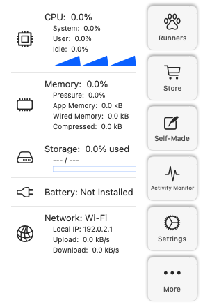 | 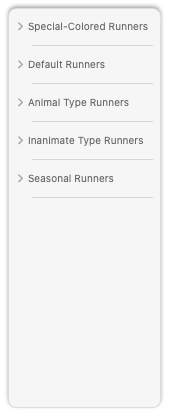 |

| General settings | System information settings |
|---|---|
| 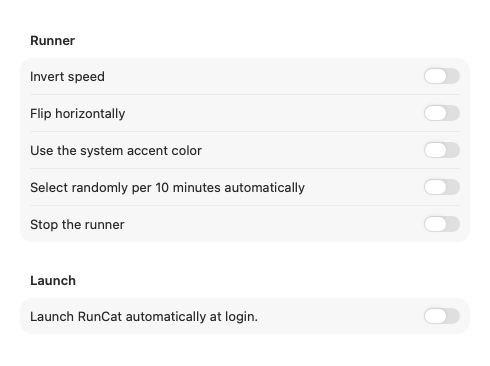 | 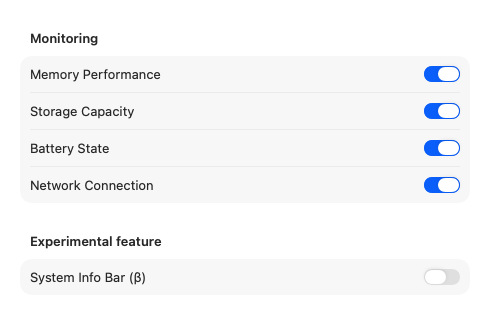 |

| System information bar settings | Self-made runner editor |
|---|---|
| 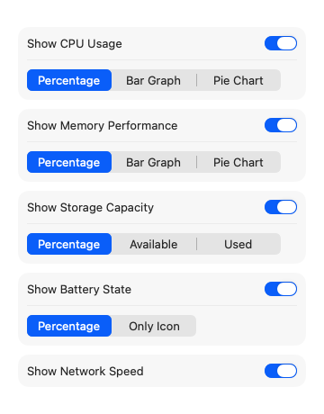 | 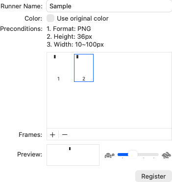 |

| Additional menus | Help |
|---|---|
| 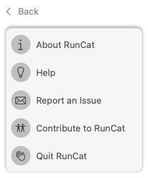 | 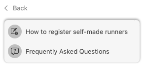 |

| System information bar confirmation | Menu bar notch preview |
|---|---|
| 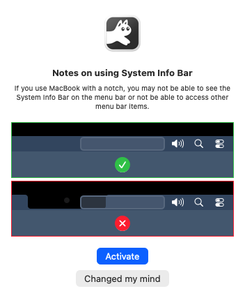 |  |

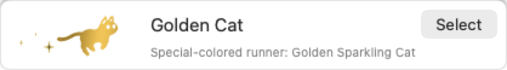

## Classic vs. RunCatNeo Comparison

The Neo column refers to the pinned source snapshot [`592cd606`](https://github.com/runcat-dev/RunCatNeo/tree/592cd606e735ce20da98d9ae62ecf1a2608635d7); later versions may differ. Classic describes this project.

| Feature | RunCat Classic v1.0.0 | RunCatNeo at the pinned snapshot |
|---|---|---|
| Deployment | macOS 14+; verified on 27.2 | macOS 26+ target |
| Built-in runners | 78, including 7 color runners | 8, all template |
| Default cat | 5 frames, 28×18 pt | Same visible pixels |
| Animation | Discrete Core Animation with phase-preserving speed changes | Same core mathematics |
| Navigation | Classic dashboard and two settings tabs | Modern menus and settings |
| Runner showcase | 57 runners with free community selection | No classic store |
| Custom runners | Separate window, up to 50 frames | Settings editor, up to 30 frames |
| Color | Template, original color and accent tint | Built-in templates; custom runners can use original color |
| Random selection and stopping | Classic scope and confirmation flow | Different workflow |
| System information bar | Classic percentage, bar, pie and other indicator modes | Redesigned metrics bar |
| JSON custom metrics | Not implemented | File watching |

## Architecture & Status-Bar Animation

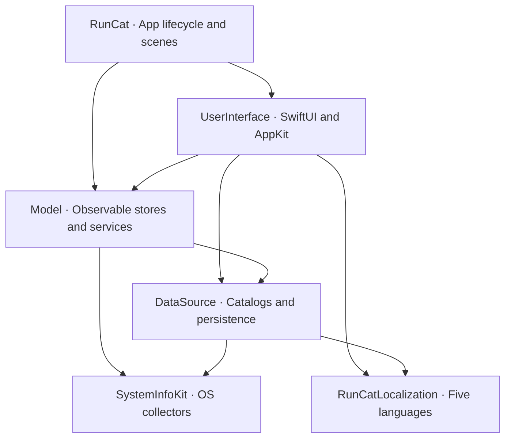

| Module | Responsibility |
|---|---|
| `RunCat` | App shell, scenes, icon and bundle metadata |
| `UserInterface` | Classic dashboard, settings, runner showcase, custom editor and status-bar rendering |
| `Model` | `@MainActor @Observable` stores, actions, services and sleep/wake handling |
| `DataSource` | Catalogs, dependency clients, UserDefaults and Application Support persistence |
| `SystemInfoKit` | CPU, memory, storage, battery and network collectors using Mach, IOKit and SystemConfiguration |
| `RunCatLocalization` | Five languages across eight localization tables |

Active modules live in `LocalPackage/Sources/`, with no remote SwiftPM dependencies. `LocalPackage/Packages/SystemInfoKit` is an upstream reference copy, not the active target.

### Discrete keyframe timeline and phase preservation

`CAKeyframeAnimation(keyPath: "contents")` uses the original frame order, `.discrete` interpolation and infinite repetition. For `N` frames, the base cycle lasts `N / 2` seconds. The default cat is 28×18 pt; other runners are normalized according to their original canvas proportions. CPU input sets speed to `clamp(CPU% / 5, 1, 20)`, with inverse speed `(21 − speed) / 2`.

Template frames animate a tinted mask layer; original-color frames animate the main layer. When speed changes, the engine reads the current local phase at one shared host time, then updates `timeOffset`, `beginTime` and `speed` so playback continues from that phase. Pausing freezes the local clock; sleep switches to the sleeping cat, and wake restores the running phase. A background composition layer supports the Apple Silicon status item, with a static fallback. CPU sampling does not rebuild the SwiftUI animation each frame.

## Build, Test & Install from Source

Requires macOS, full Xcode and Swift 6.2+. The deployment target is macOS 14; local validation uses Apple Silicon, macOS 27.2 and Xcode 27.2. Run from the repository root after cloning:

```sh
git clone https://github.com/HAOGRE/RunCatClassic.git
cd RunCatClassic

swift test --package-path LocalPackage
python3 scripts/verify_resources.py

xcodebuild -project RunCat.xcodeproj -scheme RunCat \
  -configuration Release -derivedDataPath /tmp/runcat-build build

codesign --force --deep --sign - \
  /tmp/runcat-build/Build/Products/Release/RunCat.app
codesign --verify --deep --strict --verbose=2 \
  /tmp/runcat-build/Build/Products/Release/RunCat.app
swift scripts/verify_built_resources.swift \
  /tmp/runcat-build/Build/Products/Release/RunCat.app
```

Installation replaces `/Applications/RunCat.app`; preferences and custom runner data are stored separately. These commands back up any existing app before installing:

```sh
runcat_backup_dir=$(mktemp -d /tmp/runcat-backup.XXXXXX)
killall RunCat 2>/dev/null || true
if [ -d /Applications/RunCat.app ]; then
  mv /Applications/RunCat.app "$runcat_backup_dir/RunCat.app"
fi
ditto /tmp/runcat-build/Build/Products/Release/RunCat.app \
  /Applications/RunCat.app
codesign --verify --deep --strict --verbose=2 /Applications/RunCat.app
open /Applications/RunCat.app
```

The build defaults to the host architecture; the release DMG is arm64. Resource verification covers original hashes, canvases, APNGs, symbols, localization and compiled image pixels.

<a id="self-made-runners"></a>
## Self-Made Runners

1. Click the menu bar runner, then click **Self-Made** on the dashboard to open the separate editor.
2. Enter a unique name for your runner. Click **+ / Add PNG** below the frame list, or drop PNG files into it. Add **1–50 frames**, each **36 px high** and **10–100 px wide**.
3. Enable **Use original color** to retain PNG colors. Disable it for template rendering that follows the menu bar appearance or accent tint.
4. Drag frame thumbnails to reorder playback; select a frame and use **−** to remove it. Check the animation with the preview speed slider.
5. Click **Register**. The runner is saved locally. Return to the dashboard, open **Runners**, and select it from the **Self-Made Runners** category to use it in the menu bar.

<a id="faq"></a>
## FAQ

**Is this the official RunCat or RunCatNeo?**

This is an independent community revival of the classic 12.2.1 experience with its own v1.0.0 version. [RunCatNeo](https://github.com/runcat-dev/RunCatNeo) is the official modern open-source macOS project by Takuto Nakamura / runcat-dev.

**What if the first launch is blocked?**

The release is not notarized. Follow the [download instructions](#download) to remove quarantine after checking the source.

**Which Macs are supported?**

The deployment target is macOS 14+, verified on Apple Silicon with macOS 27.2. The v1.0.0 DMG is arm64; Intel can be built from source. Wider OS, Intel and multiple-display coverage still needs testing.

**Why does the runner change speed?**

By default, playback follows CPU usage using the classic speed formula and discrete Core Animation frames. Settings control speed behavior; inverse speed and horizontal mirroring are separate options.

**Why are battery details missing?**

Desktop Macs without a battery hide battery detail rows. The collector supports old and new IORegistry layouts, including macOS 27's nested `BatteryData`; available values depend on hardware and OS.

**Does the store charge money?**

All runners and the custom-runner editor are free. The showcase offers one-click selection with no prices, purchase buttons or restore-purchases row.

**How do I report issues or contribute?**

Use **More → Report an Issue** to open a [GitHub issue](https://github.com/HAOGRE/RunCatClassic/issues/new) with version and system details prefilled; review and edit them before submitting. **More → Contribute to RunCat** opens this repository. Issues and pull requests are welcome.

<a id="references--credits"></a>
## References & Credits

- **[RunCatNeo](https://github.com/runcat-dev/RunCatNeo)** and **[RunCatNeo Website](https://runcat-dev.github.io/RunCatNeo/?lang=en)** — The official modern open-source RunCat for macOS by Takuto Nakamura ([`Kyome22`](https://github.com/Kyome22)) / `runcat-dev`, referenced for architecture and animation comparisons.
- **[SystemInfoKit](https://github.com/Kyome22/SystemInfoKit)** — The macOS performance metrics library by Takuto Nakamura, used and adapted for CPU, memory, storage, battery and network collectors in this project. Licensed under **Apache-2.0**, Copyright 2020 Takuto Nakamura; see the [retained license](LocalPackage/Sources/SystemInfoKit/LICENSE) and [provenance](docs/phase3/SystemInfoKit-provenance.md).
- **[RunCat 365](https://github.com/Kyome22/RunCat365)** — Open-source RunCat for Windows by Takuto Nakamura, referenced for open-source project structure and animation conventions.
- **Original [RunCat 12.2.1](https://kyome.io/runcat/index.html)** — The original macOS menu bar application, its 78 built-in runner animations and artwork were created by **[Takuto Nakamura (Kyome)](https://kyome.io/)**.

## License

The community revival code is licensed under the [MIT License](LICENSE), Copyright (c) 2026 HAOGRE. SystemInfoKit retains its Apache-2.0 license. Original RunCat 12.2.1 runner artwork, icons and localization strings retain their original attribution and rights with Takuto Nakamura / Kyome; the MIT license does not relicense those materials. License notices are included in the app's resources.
