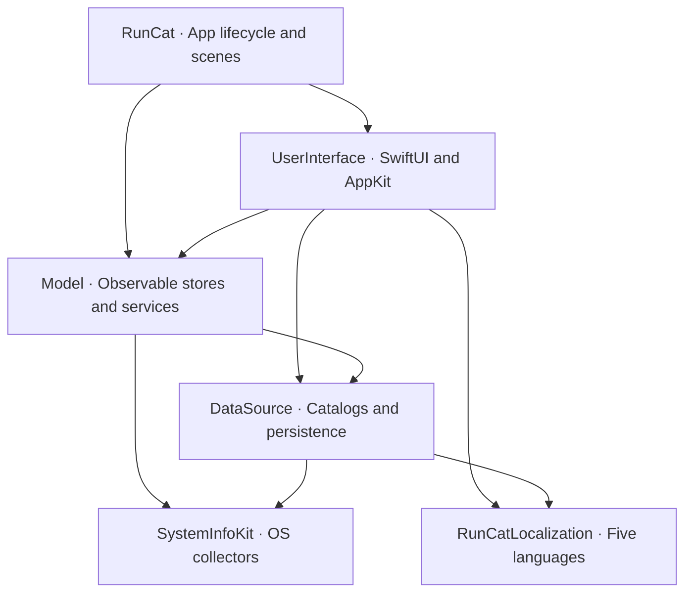

# RunCat Classic · 12.2.1 Revival


**让经典跑猫继续跑在新 macOS 上。Reviving the complete classic RunCat experience on modern macOS.**

[中文](#中文) · [English](#english) · [界面 / Gallery](#gallery) · [构建 / Build](#build-test--install) · [Phase 5 report](docs/phase5/phase5_report.md)

## 中文

RunCat Classic 是面向 RunCat **12.2.1** 的社区复活工程：以反汇编、Swift 类型元数据、原始本地化表和资源清单为依据，重建经典菜单、78 个内置跑者、商品橱窗、自制跑者编辑器，以及独立系统信息栏。目标是恢复经典版的完整体验和可核查的布局、动画语义。

macOS 27 改变了 `AppleSmartBattery` 的 IORegistry 数据布局：容量等数据可移入嵌套的 `BatteryData`，部分信息来自 `AppleSmartBatteryPack`。经典采集代码依赖旧的平铺字段，因而无法正确读取新系统的电池数据。本工程按实际字段结构选择路径，同时保留传统 Apple Silicon / Intel 读取与无电池桌面 Mac 的行为；不依赖硬编码系统版本。具体失效表现仍取决于设备和系统提供的字段。

RunCatNeo 是独立的现代化产品路线，增加了自定义指标与现代并发结构，但精简了经典内容库和旧导航。想继续使用旧版角色、商店式浏览、自制独立窗口、随机选择及强调色的人，需要完整的经典复原。这里没有用增加动画插值来模拟“旧版手感”：经典版和所研究的 Neo 都使用离散 Core Animation 时间轴。

本工程已实现结构与主要交互的保真恢复；原生控件会随 macOS 改变外观，**尚未完成跨系统逐像素 1:1 验收**。社区模式默认解锁内容，商店保留原始商品与 APNG 展示、选用和恢复入口，不执行真实付费交易。

## Classic 与 Neo / Comparison

Neo 列依据固定源码快照 [`592cd606e735ce20da98d9ae62ecf1a2608635d7`](https://github.com/runcat-dev/RunCatNeo/tree/592cd606e735ce20da98d9ae62ecf1a2608635d7)，并不概括其后续版本。Classic 列描述本工程。

The Neo column refers to that pinned source snapshot; the Classic column describes this revival.

| 特性 / Feature | Classic RunCat 12.2.1 · 本工程 / This project | RunCatNeo · Pinned snapshot |
|---|---|---|
| 系统要求 / Deployment | macOS 14+；本机验证 macOS 27.2 / verified locally on 27.2 | macOS 26+ target |
| 内置跑者 / Built-in runners | 78 个，含 7 个彩色角色 / 78, including 7 in original color | 8 个，均模板 / 8, all template |
| 原始动画页 / Source frames | 514 角色页 + 10 功能页 / runner + functional frames | 50 内置帧 / built-in frames |
| 默认猫 / Default cat | 5 帧，56×36 px → 28×18 pt / 5 frames | 同样可见像素 / same visible pixels |
| 动画引擎 / Animation | discrete `CAKeyframeAnimation`，变速保相位 / continuous phase when speed changes | 相同基础数学 / same core mathematics |
| Dashboard | 系统信息、跑者、更多、帮助四上下文 / four contexts | 较扁平的菜单与 Picker / flatter menu and picker |
| 设置 / Settings | General / System Info 两 Tab / two tabs | General / Runner / Metrics / Donation |
| 商品浏览 / Storefront | 59 项商品、原始 APNG；社区免费选用 / 59 products, free community selection | 不保留旧商品商店 / no classic product store |
| 自制跑者 / Custom runners | 独立窗口，最多 50 帧，PNG、拖放重排、预览 / separate window, up to 50 frames | 设置内编辑，最多 30 帧 / settings editor, up to 30 frames |
| 颜色 / Color | 模板 / 原色、系统强调色 / template, original color, accent tint | 内置模板；自制可原色 / built-in templates, custom original color |
| 随机与停止 / Random & stop | 经典随机选择范围、停止确认 / classic random selection and stop confirmation | 未保留完整旧流程 / full classic flow absent |
| 系统信息栏 / Metrics bar | CPU / 内存百分比、条形、饼图；磁盘、电池、网络 / classic indicator modes | 新 MetricsBar 与自定义指标 / redesigned bar with custom metrics |
| 网络口径 / Network sampling | 主物理接口；VPN 默认路由下优先活动 `en0`，再选硬件 IPv4 接口 / physical interface fallback under tunnels | AF_LINK 接口累计 / aggregate AF_LINK counters |
| 电池 / Battery | 旧 UI / health 语义 + macOS 27 嵌套数据兼容 / classic presentation with new schema support | 新采集结构 / modern collection schema |
| JSON 自定义指标 / Custom metrics | 未实现 / not implemented | 支持文件监听 / supported with file watching |
| 本地化 / Localization | English、简体中文、日本語、한국어、Français | 现代产品的独立文案 / independent modern product copy |

## Gallery

原生 SwiftUI / AppKit 组件截图，浅色模式。Dashboard 的桌面无电池示例仅显示摘要；网络来自当前硬件接口，展示 IP 替换为文档地址 `192.0.2.1`。实机审阅图另见 [Phase 4 UI Review](<docs/phase4/evidence/Phase 4 UI Review-live.png>)。

Native SwiftUI / AppKit renders in light appearance. The dashboard shows a desktop without a battery and the host's physical network; the gallery masks its IP with `192.0.2.1`. Live diagnostics are separate from the shipping app.

| Dashboard | Runners |
|---|---|
|  |  |
| General | System Info |
|  |  |
| System Info Bar | Self-Made |
|  |  |


## Architecture / 架构



| 模块 / Module | 职责 / Responsibility |
|---|---|
| `RunCat` | `@main`、应用生命周期、菜单栏和窗口 Scene、图标与 Info.plist / app shell, scenes, icon and bundle metadata |
| `UserInterface` | 经典 Dashboard、两 Tab 设置、商店、自制编辑器、菜单栏图层桥接 / classic views and status-bar rendering |
| `Model` | `@MainActor @Observable` Store、Action → send、监控与跑者服务、睡眠唤醒 / observable state, actions, services and sleep/wake |
| `DataSource` | 跑者 / 商品目录、依赖客户端、UserDefaults 与 Application Support 持久化 / catalogs, dependency clients and persistence |
| `SystemInfoKit` | Mach、IOKit、SystemConfiguration 采集 CPU、内存、存储、电池和网络 / five system collectors with classic value formatting |
| `RunCatLocalization` | 五语言 × 八业务表；系统信息表由 SystemInfoKit 管理 / five languages across eight business tables |

运行中的模块位于 `LocalPackage/Sources/`，无远程 SwiftPM 依赖。`LocalPackage/Packages/SystemInfoKit` 为保留的上游参考副本，不是运行中的 target。

The active modules live under `LocalPackage/Sources/`, with no remote SwiftPM dependencies. The vendored `LocalPackage/Packages/SystemInfoKit` is a reference copy, not the active target.

### 状态栏动画 / Status-bar animation

- `CAKeyframeAnimation(keyPath: "contents")` 使用原始播放序列和 `.discrete`，无限重复，基础周期为 `frames.count / 2` 秒。默认猫保持 18 pt 高、28 pt 宽；其他角色按原始画布比例归一化。
- CPU 速度为 `clamp(CPU% / 5, 1, 20)`；反向速度为 `(21 − speed) / 2`。水平翻转和颜色选择独立于速度反向。
- 模板动画运行在 mask layer，原色动画运行在主 layer；变速使用同一个 host time 更新 `timeOffset`、`beginTime` 和 `speed`，保持相位连续。暂停冻结局部时钟，睡眠切换睡猫，唤醒恢复运行相位。
- Apple Silicon 通过合成背景层处理活动状态项的静态图像；其他显示器使用静态回退。CPU 采样不逐帧驱动 SwiftUI 重建动画。

The engine animates `contents` with discrete keyframes, the original playback order and an infinite `N/2`-second base cycle. CPU input controls playback speed using the classic formula. Template frames animate a tinted mask; color frames animate the main layer. Updating the layer clock preserves phase through speed changes, freezing and wake-up. A background composition layer supports the Apple Silicon status item, with a static fallback for other displays. This is a Core Animation timeline rather than a SwiftUI frame timer.

## Build, Test & Install

需要 macOS、完整 Xcode 和 Swift 6.2+。部署目标 macOS 14；当前实测为 Apple Silicon、macOS 27.2、Xcode 27.2、Swift 6.4.2。Intel、Universal、多显示器以及旧系统硬件矩阵尚未实机验收。

Requires macOS, full Xcode and Swift 6.2+. The deployment target is macOS 14. Local validation used Apple Silicon, macOS 27.2, Xcode 27.2 and Swift 6.4.2; the wider hardware/OS matrix remains unverified.

从仓库根目录执行 / Run from the repository root:

```sh
# Unit / integration tests in both configurations
swift test --package-path LocalPackage
swift test --package-path LocalPackage -c release

# Release application
xcodebuild -project RunCat.xcodeproj -scheme RunCat \
  -configuration Release -derivedDataPath /tmp/runcat-release-build build

# Ad-hoc sign and validate the complete bundle
codesign --force --deep --sign - \
  /tmp/runcat-release-build/Build/Products/Release/RunCat.app
codesign --verify --deep --strict --verbose=2 \
  /tmp/runcat-release-build/Build/Products/Release/RunCat.app

# Source hashes, original canvases, APNGs, symbols and localized values
python3 scripts/verify_resources.py

# Compiled asset pixels, APNG bytes, localization and bundle resources
swift scripts/verify_built_resources.swift \
  /tmp/runcat-release-build/Build/Products/Release/RunCat.app
```

安装会替换 `/Applications/RunCat.app`，保留独立的用户偏好及自制数据。以下命令用于本机安装。

Installation replaces `/Applications/RunCat.app`; preferences and custom runner data live separately.

```sh
killall RunCat 2>/dev/null || true
rm -rf /Applications/RunCat.app
ditto /tmp/runcat-release-build/Build/Products/Release/RunCat.app \
  /Applications/RunCat.app
codesign --verify --deep --strict --verbose=2 /Applications/RunCat.app
open -a /Applications/RunCat.app
sleep 3
pgrep -fl '^/Applications/RunCat.app/Contents/MacOS/RunCat$'
rm -rf /tmp/runcat-release-build
```

这是本机 ad-hoc 签名构建，不是 Developer ID 签名或 Apple 公证的发行包；本机严格签名检查和成功启动不能代表可下载发行包的 Gatekeeper 认证。

This local build uses an ad-hoc signature. It is not Developer ID signed or notarized; successful local verification and launch do not establish Gatekeeper approval for downloaded distribution.

### 重新生成界面图 / Regenerate UI evidence

```sh
RUNCAT_UI_SNAPSHOTS="$PWD/docs/phase4/screenshots" \
  swift test --package-path LocalPackage \
  --filter Phase4UITests.nativeViewsHaveFiniteIntrinsicLayouts

xcodebuild -project RunCat.xcodeproj -scheme RunCat \
  -configuration Debug -derivedDataPath /tmp/runcat-phase4-build \
  CODE_SIGNING_ALLOWED=NO build
scripts/phase4_ui_review.sh /tmp/runcat-phase4-build/Build/Products/Debug
```

最后一条启动独立审阅宿主，持续写入 `docs/phase4/evidence/`；完成后退出该宿主。它与正式 RunCat 使用不同 bundle ID，审阅窗口和诊断不会进入发行应用。

The final command runs a separate review host and continuously records visible native views; quit it after review. It has a separate bundle ID and does not add review windows or diagnostics to RunCat.app.

## English

RunCat Classic is a community reconstruction of **RunCat 12.2.1**, guided by disassembly, Swift metadata, original localization tables and an auditable resource manifest. It restores the classic dashboard, 78 runners, product browser, separate custom-runner editor and optional system information bar.

The macOS 27 battery schema can move `AppleSmartBattery` properties into nested `BatteryData`, with additional data in `AppleSmartBatteryPack`. The classic collector assumed the older flat layout and could no longer read the expected values correctly. This project detects the available structure, supports traditional Apple Silicon and Intel fields, and hides battery detail rows on desktop Macs without a battery. Exact failure symptoms depend on the hardware and properties exposed by the OS.

RunCatNeo follows a modern product direction, including custom metrics and newer concurrency infrastructure. Its reduced classic catalog and changed navigation do not replace the complete 12.2.1 experience for users who want the old runners, storefront, random selection, accent tint and separate editor. The comparison above is tied to a specific Neo commit, not a claim about every Neo release.

The restoration targets classic structure, layout constants, assets and interaction semantics. Native controls vary by OS, and cross-version pixel-for-pixel equivalence has not been established. Community mode unlocks the catalog and retains selection/restoration UI without real purchases. See the shared architecture, gallery and reproducible build instructions above.

## Evidence & Credits / 证据与致谢

- [Phase 2: resources and disassembly](docs/phase2/phase2_report.md) · [36 view specifications](docs/phase2/old-views-layout-spec.md)
- [Phase 3: data and model](docs/phase3/phase3_report.md) · [SystemInfoKit provenance](docs/phase3/SystemInfoKit-provenance.md)
- [Phase 4: UI and animation](docs/phase4/phase4_report.md)
- [Phase 5: fidelity, Release validation and installation](docs/phase5/phase5_report.md)
- [Source resource manifest](docs/phase2/resource-manifest.json) · [Phase 5 validation evidence](docs/phase5/evidence/)

RunCat 由 Takuto Nakamura（Kyome）创作。感谢 [RunCatNeo](https://github.com/runcat-dev/RunCatNeo) 与 [SystemInfoKit](https://github.com/Kyome22/SystemInfoKit) 的上游工作。保留的 SystemInfoKit 许可证及来源见其 `LICENSE` 与 `VENDOR.md`。经典图像、图标及文案保留原作者归属；本仓库不将它们声明为 Neo 开源许可证覆盖的素材，也不代表官方发行。

RunCat was created by Takuto Nakamura (Kyome). Upstream license and provenance files remain with SystemInfoKit. Classic artwork, icons and copy retain their original attribution; this community reconstruction is not an official release and does not relicense those assets under Neo's license.
