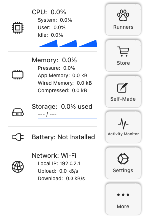
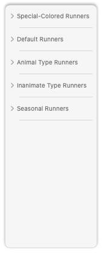
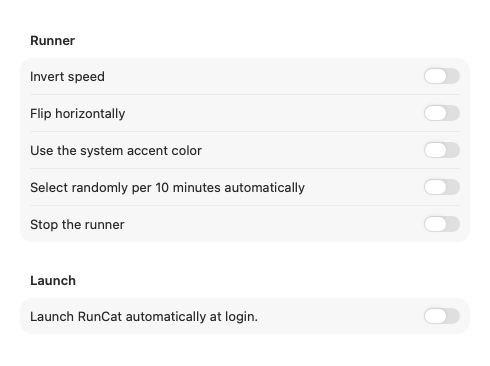
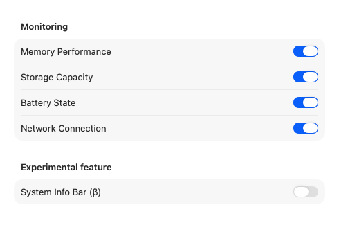
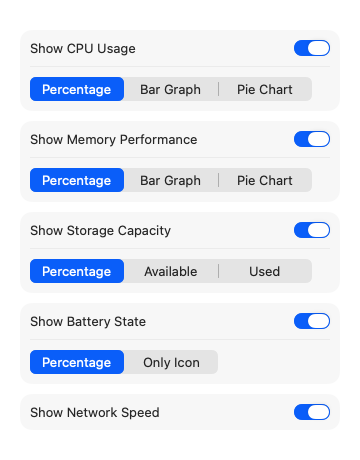
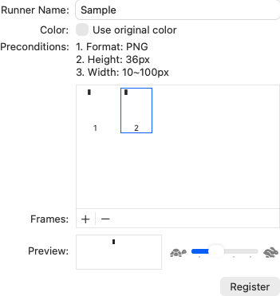
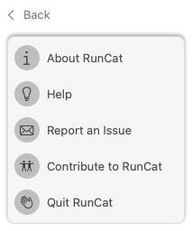
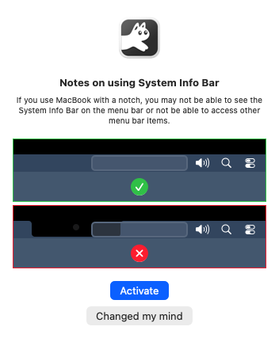
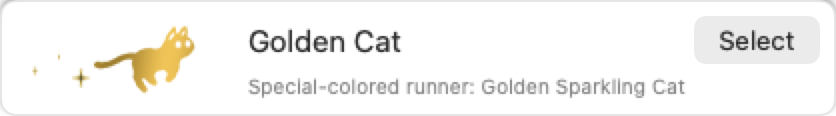
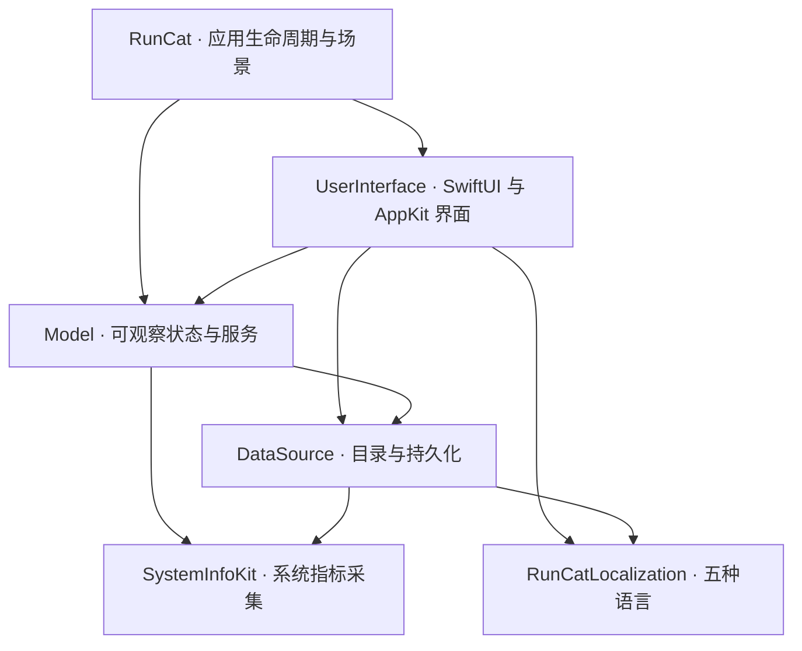

[English](README.md) · [下载 RunCat.dmg](https://github.com/HAOGRE/RunCatClassic/releases/latest/download/RunCat.dmg) · [自制跑者指南](#self-made-runners) · [常见问题](#faq) · [引用与致谢](#references--credits)

# RunCat Classic

[](https://github.com/HAOGRE/RunCatClassic/releases/tag/v1.0.0)


**让经典跑猫继续跑在新 macOS 上。**

## 下载安装

**[下载 RunCat.dmg（v1.0.0）](https://github.com/HAOGRE/RunCatClassic/releases/latest/download/RunCat.dmg)**

打开 DMG，将 `RunCat.app` 拖入「应用程序」，再从「应用程序」启动。v1.0.0 的 DMG 为 Apple Silicon（arm64）构建，最低要求 macOS 14，已在 macOS 27.2 验证。Intel 用户可从源码构建，尚未实机验证。

发行包使用临时签名，未经过 Apple 公证。如果首次打开被 Gatekeeper 阻止，请在确认下载来自本仓库后运行：

```sh
xattr -dr com.apple.quarantine /Applications/RunCat.app
open /Applications/RunCat.app
```

## 为什么选择 RunCat Classic

RunCat Classic 是由 [HAOGRE](https://github.com/HAOGRE) 维护的社区复活工程，让完整的经典 **RunCat 12.2.1** 体验延续到 **macOS 14–27+**。**本项目版本为 1.0.0。** 工程依据经典版资源、Swift 类型元数据、原始本地化表与资源清单重建菜单和交互，保留原作者 Takuto Nakamura（Kyome）的署名。官方现代 macOS 开源版本请见 [RunCatNeo](https://github.com/runcat-dev/RunCatNeo)。

- **完整经典内容**：78 个内置跑者（含 7 个彩色角色）、经典主面板、随机选择、强调色与独立系统信息栏。
- **自制跑者**：独立编辑窗口，最多 50 帧 PNG，支持模板或原色、拖放重排和动画预览。
- **适配新系统的指标采集**：CPU、内存、存储、电池和网络。修复 macOS 27 的 IORegistry 架构兼容问题，读取 `AppleSmartBattery` 内嵌套的 `BatteryData`，并支持 `AppleSmartBatteryPack` 数据，同时保留传统 Apple Silicon 和 Intel 采集路径。
- **100% 免费跑者展示**：将旧版付费商店改为免费展示窗口，提供四个分类、57 款跑者与原始 APNG 预览；一键选用并标记当前跑者。所有跑者及自制功能均免费。
- **五种语言**：英语、简体中文、日语、韩语和法语。

结构、布局常量、资源与主要交互以经典版为依据；系统原生控件外观会随 macOS 变化，尚未完成跨系统逐像素验收。最低部署版本为 macOS 14，已在 macOS 27.2 验证；其他系统版本和硬件仍需更多测试。

## 界面预览

原生 SwiftUI 与 AppKit 浅色模式截图；桌面 Mac 示例不显示电池详情，展示的 IP 已替换为文档地址 `192.0.2.1`。以下包含 `docs/phase4/screenshots/` 中的全部截图。

| 主面板 | 跑者分类 |
|---|---|
|  |  |

| 通用设置 | 系统信息设置 |
|---|---|
|  |  |

| 系统信息栏设置 | 自制跑者编辑器 |
|---|---|
|  |  |

| 更多菜单 | 帮助 |
|---|---|
|  |  |

| 系统信息栏启用确认 | 菜单栏刘海预览 |
|---|---|
|  |  |



## 经典版与 RunCatNeo 对比

Neo 列依据固定源码快照 [`592cd606`](https://github.com/runcat-dev/RunCatNeo/tree/592cd606e735ce20da98d9ae62ecf1a2608635d7)，不代表后续版本。经典版列描述本工程。

| 特性 | RunCat Classic v1.0.0 | RunCatNeo 固定快照 |
|---|---|---|
| 系统要求 | macOS 14 及以上；已在 27.2 验证 | 部署目标为 macOS 26 及以上 |
| 内置跑者 | 78 个，含 7 个彩色角色 | 8 个，均为模板渲染 |
| 默认猫 | 5 帧，28×18 点 | 相同可见像素 |
| 动画 | 离散 Core Animation；变速保持相位 | 相同基础数学逻辑 |
| 导航 | 经典主面板、两个设置标签页 | 现代菜单和设置 |
| 跑者展示 | 57 款，社区版免费选用 | 无经典商店 |
| 自制跑者 | 独立窗口，最多 50 帧 | 设置内编辑，最多 30 帧 |
| 颜色 | 模板、原色、强调色 | 内置为模板，自制可用原色 |
| 随机选择与停止 | 经典范围与确认流程 | 流程不同 |
| 系统信息栏 | 经典百分比、条形、饼图等模式 | 重新设计的信息栏 |
| JSON 自定义指标 | 未实现 | 文件监听 |

## 架构与状态栏动画



| 模块 | 职责 |
|---|---|
| `RunCat` | 应用入口、场景、图标和版本信息 |
| `UserInterface` | 经典主面板、设置、跑者展示、自制编辑器与状态栏渲染 |
| `Model` | `@MainActor @Observable` 状态、动作、服务与睡眠唤醒处理 |
| `DataSource` | 目录、依赖客户端、UserDefaults 与 Application Support 持久化 |
| `SystemInfoKit` | 通过 Mach、IOKit、SystemConfiguration 采集 CPU、内存、存储、电池和网络指标 |
| `RunCatLocalization` | 五种语言、八张本地化表 |

活动模块位于 `LocalPackage/Sources/`，无远程 SwiftPM 依赖。`LocalPackage/Packages/SystemInfoKit` 是保留的上游参考副本，不是运行中的构建目标。

### 离散关键帧时间轴与相位保持

`CAKeyframeAnimation(keyPath: "contents")` 使用原始帧顺序、`.discrete` 插值与无限重复。若有 `N` 帧，基础周期为 `N / 2` 秒。默认猫为 28×18 点；其他角色按原始画布比例归一化。CPU 速度为 `clamp(CPU% / 5, 1, 20)`，反向速度为 `(21 − speed) / 2`。

模板帧运行在着色遮罩图层，原色帧运行在主图层。变速时，引擎在同一宿主时间读取当前局部相位，再更新 `timeOffset`、`beginTime` 与 `speed`，使动画从该相位连续播放。暂停冻结局部时钟，睡眠切换睡猫，唤醒恢复运行相位。Apple Silicon 使用背景合成层支持活动状态项，并提供静态回退；CPU 采样不会逐帧触发 SwiftUI 动画重建。

## 从源码构建、测试与安装

需要 macOS、完整 Xcode 和 Swift 6.2 及以上。最低部署版本为 macOS 14；本机验证环境为 Apple Silicon、macOS 27.2、Xcode 27.2。克隆后在仓库根目录运行：

```sh
git clone https://github.com/HAOGRE/RunCatClassic.git
cd RunCatClassic

swift test --package-path LocalPackage
python3 scripts/verify_resources.py

xcodebuild -project RunCat.xcodeproj -scheme RunCat \
  -configuration Release -derivedDataPath /tmp/runcat-build build

codesign --force --deep --sign - \
  /tmp/runcat-build/Build/Products/Release/RunCat.app
codesign --verify --deep --strict --verbose=2 \
  /tmp/runcat-build/Build/Products/Release/RunCat.app
swift scripts/verify_built_resources.swift \
  /tmp/runcat-build/Build/Products/Release/RunCat.app
```

安装会替换 `/Applications/RunCat.app`；用户偏好和自制跑者数据独立保存。以下命令会先备份已有应用，再安装新版本：

```sh
runcat_backup_dir=$(mktemp -d /tmp/runcat-backup.XXXXXX)
killall RunCat 2>/dev/null || true
if [ -d /Applications/RunCat.app ]; then
  mv /Applications/RunCat.app "$runcat_backup_dir/RunCat.app"
fi
ditto /tmp/runcat-build/Build/Products/Release/RunCat.app \
  /Applications/RunCat.app
codesign --verify --deep --strict --verbose=2 /Applications/RunCat.app
open /Applications/RunCat.app
```

构建默认仅针对本机架构；发行 DMG 为 arm64。资源校验覆盖原始哈希、画布、APNG、符号、本地化及编译后图像像素。

<a id="self-made-runners"></a>
## 自制跑者指南

1. 点击菜单栏跑猫，再点击主面板上的 **自制**，打开独立的自制跑者窗口。
2. 输入不重复的跑者名称。点击帧列表下方的 **+** 按钮，或拖入 PNG 文件，添加 **1–50 帧**。每帧高度须为 **36 像素**，宽度须为 **10–100 像素**。
3. 勾选 **使用原始颜色** 保留 PNG 颜色；关闭时以模板方式渲染，随菜单栏外观或强调色着色。
4. 拖动帧缩略图调整播放顺序，选中帧后可用 **−** 删除；使用预览速度滑块检查动画。
5. 点击 **制作**。跑者会保存到本机。返回主面板，打开 **跑者**，从 **自制跑者** 分类中选用，即可用于菜单栏。

<a id="faq"></a>
## 常见问题

**这是官方 RunCat 或 RunCatNeo 吗？**

这是基于经典 12.2.1 体验的独立社区复活项目，使用自己的 v1.0.0 版本号。官方现代 macOS 开源项目为 [RunCatNeo](https://github.com/runcat-dev/RunCatNeo)，由 Takuto Nakamura / runcat-dev 开发。

**首次打开被阻止怎么办？**

发行包未公证，请按[下载安装](#下载安装)中的步骤，在确认来源后移除隔离属性。

**支持哪些 Mac？**

最低部署版本为 macOS 14，已在 Apple Silicon、macOS 27.2 验证。v1.0.0 DMG 为 arm64；Intel 可从源码构建，其他系统版本、Intel 和多显示器硬件组合仍需更多验证。

**为什么跑者速度会变化？**

默认速度跟随 CPU 使用率，采用经典公式与离散 Core Animation 帧。设置可调整速度行为；反向速度与水平翻转是独立选项。

**为什么没有电池详情？**

无电池的桌面 Mac 会隐藏电池详情。采集器兼容新旧 IORegistry 布局，包括 macOS 27 的嵌套 `BatteryData`；实际可用值取决于硬件与系统。

**商店是否收费？**

社区版的全部跑者和自制功能均免费。展示窗口提供一键选用，不显示价格、购买按钮或恢复购买入口。

**如何报告问题或参与？**

使用 **更多 → 反馈问题** 打开预填版本与系统信息的 [GitHub 问题页面](https://github.com/HAOGRE/RunCatClassic/issues/new)，提交前可编辑内容。**更多 → 贡献 RunCat** 打开本仓库；欢迎提交问题与拉取请求。

<a id="references--credits"></a>
## 引用与致谢

- **[RunCatNeo](https://github.com/runcat-dev/RunCatNeo)** 与 **[RunCatNeo 官方网站](https://runcat-dev.github.io/RunCatNeo/?lang=en)** — Takuto Nakamura（[`Kyome22`](https://github.com/Kyome22)）/ `runcat-dev` 开发的官方现代 macOS 开源 RunCat，本工程用于架构与动画对比参考。
- **[SystemInfoKit](https://github.com/Kyome22/SystemInfoKit)** — Takuto Nakamura 开发的 macOS 系统性能指标库，本工程使用并适配其 CPU、内存、存储、电池与网络采集器。采用 **Apache-2.0 许可证**，Copyright 2020 Takuto Nakamura；参见[保留的许可证](LocalPackage/Sources/SystemInfoKit/LICENSE)与[来源说明](docs/phase3/SystemInfoKit-provenance.md)。
- **[RunCat 365](https://github.com/Kyome22/RunCat365)** — Takuto Nakamura 开发的 Windows 开源 RunCat，本工程参考其开源项目组织方式与动画约定。
- **原始 [RunCat 12.2.1](https://kyome.io/runcat/index.html)** — 原始 macOS 菜单栏应用、78 个内置跑者动画及其美术资源，均由 **[Takuto Nakamura (Kyome)](https://kyome.io/)** 创作。

## 许可证

社区复活代码采用 [MIT 许可证](LICENSE)，Copyright (c) 2026 HAOGRE。SystemInfoKit 保留 Apache-2.0 许可证。经典 RunCat 12.2.1 跑者美术、图标与本地化字符串保留 Takuto Nakamura / Kyome 的原始署名与权利，不因本仓库的 MIT 许可证而重新授权。许可证声明随应用资源一同分发。
